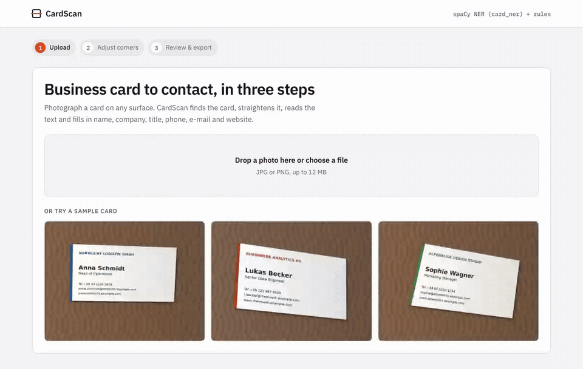
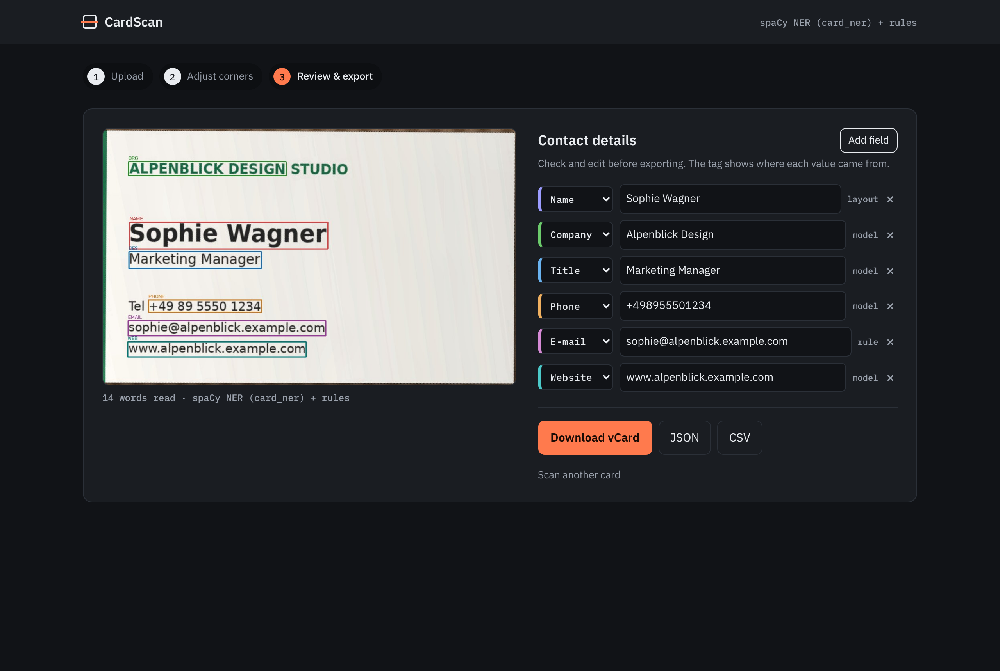
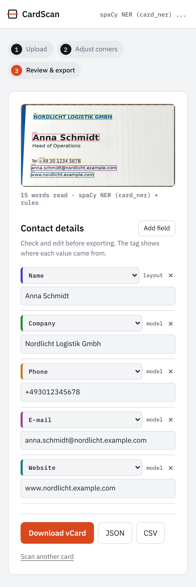
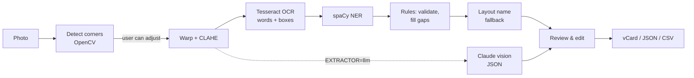

# CardScan: Business Card & Document Scanner

Photograph a business card on any surface. CardScan finds the card, straightens it, reads the text and fills in **name, company, job title, phone, e-mail and website**, ready to download as a vCard for your phone or as JSON/CSV.

The project started as a **freelance job for a German client on Upwork**: automating the scanning of business cards and documents and turning them into structured contact data. The client's code and data are confidential and not part of this repository. This repo holds the public demo (`legacy/`) and a rebuilt v2 with its own architecture, a fixed and re-evaluated NER model, tests and a new web app.



| Results (dark theme) | Mobile |
|---|---|
|  |  |

## Features

- **Automatic document detection.** OpenCV finds the card's four corners, even when it is tilted, shadowed or unevenly lit.
- **Adjustable corners.** If detection is off, drag the handles onto the card before extracting.
- **Perspective correction and lighting fix.** The card is flattened to a rectangle and contrast is evened out with CLAHE.
- **OCR with positions.** Tesseract 5 reads every word with its bounding box (English + German by default).
- **Field extraction with three layers:** a custom-trained spaCy NER model, rule-based validation for phone/e-mail/web, and a layout fallback for the name.
- **Optional LLM mode.** Claude vision extracts the same fields as validated JSON, for unusual layouts or languages.
- **Review before export.** Every field shows where it came from (model, rule, layout or LLM) and can be edited, retyped or removed.
- **Export** as vCard 3.0, JSON or CSV.
- **No real personal data.** Demo cards are generated synthetically with invented people and `example.com` domains.

## AI models and techniques

| Stage | Model / technique | Why |
|---|---|---|
| Card detection | OpenCV: Gaussian blur → Canny edges → morphological closing → largest convex 4-point contour | Fast, needs no training, works on any background with visible card edges |
| Flattening | Perspective transform + CLAHE on the L channel (LAB) | Straight, evenly lit text gives Tesseract the best input |
| OCR | **Tesseract 5** (LSTM engine), `eng+deu`, sparse-text mode, words sorted into lines | Business cards are scattered short lines, not paragraphs |
| Field extraction | **spaCy NER** (tok2vec + transition-based NER), trained on 187 labelled cards | Learns which words are names, companies and titles |
| Validation | Regex rules for e-mail, website and phone | Corrects mislabelled structured fields, fills gaps |
| Name fallback | Layout heuristic: tallest unlabelled 2–3-word capitalised line | On cards, the name is usually the biggest text |
| Alternative extractor | **Claude vision** (`claude-sonnet-5-5`), JSON output validated by the same rules | `EXTRACTOR=llm`; handles layouts the small NER model never saw |

## Pipeline



The NER model runs on a spaCy `Doc` built directly from the OCR words, so every predicted entity maps back to the exact words and boxes it came from.

## Fixing the NER model: v1 → v2

While rebuilding, I found that the v1 training data used every BIO tag as its own entity label (`B-PHONE`, `I-PHONE`), so each word became a separate entity, and a few tags had typos (`B-PHOE`, `I-OR`). v2 converts the tags into proper multi-word entities, fixes the typos and splits the data **by card** (187 train / 40 dev / 40 test), so no card appears in both training and test.

Both label schemes were trained on the same split and scored with the same metric: entity-level exact match F1 on the 40 unseen test cards (`scripts/train_ner.py`, `scripts/evaluate.py`, results in [`docs/ner_metrics.json`](docs/ner_metrics.json)).

| Label | v1 label scheme | v2 fixed labels | v2 + rules (shipped) |
|---|---|---|---|
| Name | 0.20 | 0.23 | 0.23 |
| Company | 0.21 | 0.38 | 0.38 |
| Title | 0.39 | 0.39 | 0.39 |
| Phone | 0.48 | 0.53 | 0.53 |
| E-mail | 0.74 | 0.88 | 0.88 |
| Website | 0.84 | 0.84 | 0.86 |
| **Overall F1** | **0.45** | **0.54** | **0.54** |

One finding changed the design: letting the regex rules *override* the model lowered e-mail and website scores, because OCR noise breaks strict patterns more often than it confuses the model. In v2 the model goes first and rules only fill gaps and correct clearly mislabelled values.

The scores are modest because the training set is small (187 cards) and noisy OCR output is scored by exact match. For new card designs, the layout fallback and the optional LLM extractor cover what the model misses, and the review step lets the user correct anything before export.

## Quick start

Install Tesseract first:

```bash
# macOS
brew install tesseract tesseract-lang
# Ubuntu / Debian
sudo apt install tesseract-ocr tesseract-ocr-deu
```

Then:

```bash
git clone https://github.com/tolgaboroglu/document_scanner_.git
cd document_scanner_
python -m venv .venv && source .venv/bin/activate     # Windows: .venv\Scripts\activate
pip install -r requirements.txt
python -m docscan.server                              # http://127.0.0.1:5000
```

Click a sample card or upload your own photo. For the LLM extractor, copy `.env.example` to `.env`, add `ANTHROPIC_API_KEY` and set `EXTRACTOR=llm`.

Use it from Python:

```python
import cv2
from docscan.pipeline import CardScanner
from docscan.export import to_vcard

result = CardScanner().scan(cv2.imread("samples/card_1.jpg"))
print(result.contact.to_dict()["grouped"])
print(to_vcard(result.contact))
```

Tests, retraining and samples:

```bash
pip install -r requirements-dev.txt
pytest -q                                                            # 17 tests
python scripts/train_ner.py legacy/business_card_/BusinessCardNER/businessCard.csv
python scripts/evaluate.py legacy/business_card_/BusinessCardNER/businessCard.csv
python scripts/make_samples.py                                        # regenerate synthetic cards
```

## Project structure

```
docscan/
  scanner.py    corner detection, perspective warp, CLAHE
  ocr.py        Tesseract words with boxes, reading-order lines
  ner.py        BIO decoding, spaCy NER on OCR words
  rules.py      e-mail / web / phone patterns and normalisation
  extract.py    merge model + rules, line splitting, layout name fallback
  llm.py        optional Claude vision extractor with validation
  export.py     vCard, JSON, CSV
  pipeline.py   CardScanner: photo → contact
  server.py     Flask app and JSON API
templates/, static/   web UI (upload → corners → review)
models/card_ner/      trained NER model (v2)
samples/              synthetic card photos + ground truth
scripts/              train_ner.py, evaluate.py, make_samples.py
tests/                pytest suite
legacy/               v1 demo app, notebooks and original model
```

## v1 → v2 at a glance

| | v1 | v2 |
|---|---|---|
| Corner detection | Largest 4-point contour, fixed fallback points if none | Convex-quad and area checks, fallback frame inside the image edges |
| OCR | Default page mode, text joined then re-tokenised | Sparse-text mode, words kept with boxes and lines |
| NER labels | One entity per word, BIO tags as labels | Proper multi-word entities, typos fixed |
| Evaluation | spaCy's score on its own broken labels | Card-level split, entity F1 on unseen cards |
| Structured fields | Model only | Model + rule validation + layout fallback |
| LLM option | None | Claude vision with validated JSON |
| Output | Text on screen | Editable fields, vCard / JSON / CSV |
| Tests | None | 17 tests on synthetic cards |

## Credits and data

- The v1 demo in `legacy/` was built following the structure of the course *"Intelligently Extract Text & Data from Document with OCR NER"*. v2 is a separate implementation.
- The NER training data (`legacy/business_card_/BusinessCardNER/businessCard.csv`) is the course's labelled business-card dataset. Demo images in `samples/` are synthetic.
- Video walkthrough of v1: [Part 1](https://youtu.be/ihsTjo_Youw) · [Part 2](https://youtu.be/OV_yRhQuAfs)

---

Built by **Tolga Boroğlu**, AI developer. Available for OCR, document AI and automation projects on Upwork.
