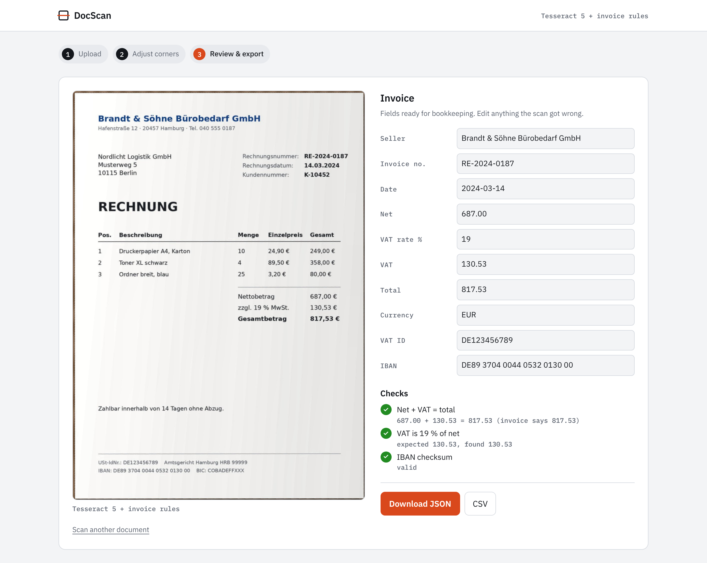
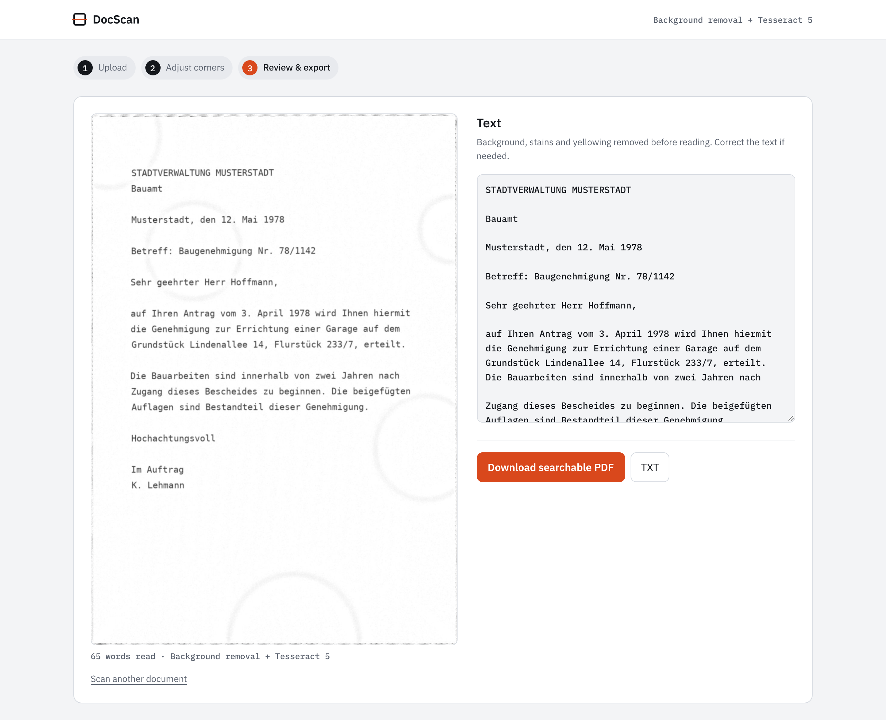
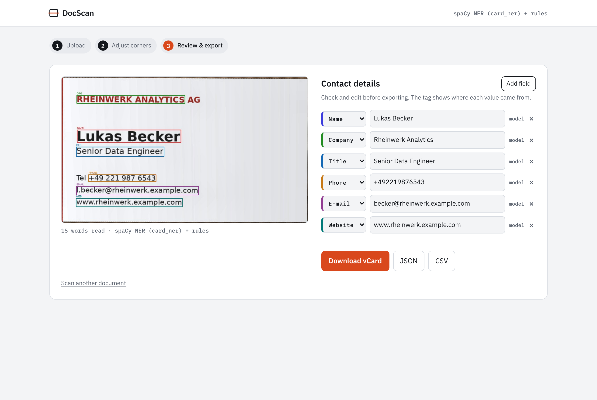
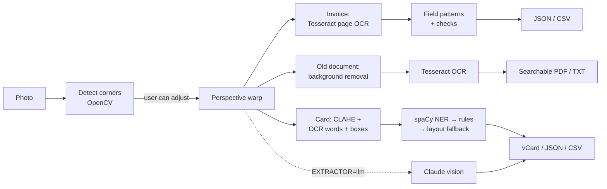

# DocScan: Invoice, Archive & Business Card Scanner

Photograph a document on any surface. DocScan finds the page, straightens it and turns it into data:

- **Invoices** → invoice number, date, net, VAT, total, VAT ID and IBAN, with automatic bookkeeping checks
- **Old paper records** → stains and yellowing removed, then plain text and a **searchable PDF** for the archive
- **Business cards** → name, company, title, phone, e-mail and website, downloadable as a vCard


## The client project behind it

This started as a **freelance job on Upwork for a German client**. The business had two piles of paper to get rid of:

1. **Supplier invoices** that someone typed into the bookkeeping system by hand, which was slow and caused typos in amounts and bank details.
2. **Old paper records** (letters, permits, contracts going back decades) that nobody could search, stored in folders that were yellowing and stained.

The goal was a tool that turns a phone photo of any of these into usable data: fields ready for bookkeeping for invoices, searchable files for the archive, and contacts for the business cards collected at trade fairs.

The client's documents, code and data are confidential and are **not** in this repository. Every sample here is synthetic and recreates the same document types: a German supplier invoice, a typewritten 1970s letter on stained paper, and German business cards. All names, companies and numbers are invented (the IBAN is the standard documentation example). This repo holds the original public demo (`legacy/`) and a rebuilt v2 with its own architecture, tests and a new web app.

| Invoice → bookkeeping fields + checks | Old document → searchable PDF |
|---|---|
|  |  |

| Business card → vCard | Mobile |
|---|---|
|  |  |

## Features

**All document types**
- **Automatic page detection.** OpenCV finds the document's four corners, even when it is tilted, shadowed or unevenly lit.
- **Adjustable corners.** If detection is off, drag the handles onto the corners before extracting.
- **Perspective correction.** The page is flattened to a rectangle before reading.
- **Review before export.** Every extracted value can be edited.

**Invoices**
- Extracts invoice number, date (converted to ISO), net, VAT rate, VAT, total, VAT ID and IBAN from German and English invoices; handles `1.234,56` and `1,234.56` amounts.
- **Bookkeeping checks** flag OCR errors before data reaches accounting: net + VAT = total, VAT matches the stated rate, IBAN mod-97 checksum, required fields present.
- Export as JSON or CSV.

**Old documents**
- **Background removal** (divide by a median-blurred copy of the page) wipes out stains, yellowing and uneven light while keeping the letters.
- Export as a **searchable PDF** (the scan with an invisible text layer) or plain text.

**Business cards**
- Custom-trained spaCy NER model, rule-based validation for phone/e-mail/web and a layout fallback for the name.
- Optional Claude vision extractor for unusual layouts.
- Export as vCard 3.0, JSON or CSV.

## AI models and techniques

| Stage | Model / technique | Why |
|---|---|---|
| Page detection | OpenCV: Gaussian blur → Canny edges → morphological closing → largest convex 4-point contour | Fast, needs no training, works on any background with visible card edges |
| Flattening | Perspective transform + CLAHE on the L channel (LAB) | Straight, evenly lit text gives Tesseract the best input |
| OCR | **Tesseract 5** (LSTM engine), German + English | Cards: sparse-text mode with word boxes. Invoices and letters: column-aware page mode |
| Invoice fields | Label-anchored patterns + amount parser + checks (sum, VAT rate, IBAN mod-97) | Invoices have fixed vocabulary ("Rechnungsnummer", "Gesamtbetrag"); checks catch misread digits |
| Old paper cleanup | Background division (median blur) | Removes stains and yellowing; 10 → 14 of 14 lines read exactly on the sample letter |
| Searchable PDF | Tesseract PDF renderer | Keeps the original look, adds selectable text |
| Card fields | **spaCy NER** (tok2vec + transition-based NER), trained on 187 labelled cards | Learns which words are names, companies and titles |
| Validation | Regex rules for e-mail, website and phone | Corrects mislabelled structured fields, fills gaps |
| Name fallback | Layout heuristic: tallest unlabelled 2–3-word capitalised line | On cards, the name is usually the biggest text |
| Alternative extractor | **Claude vision** (`claude-sonnet-5-5`), JSON output validated by the same rules | `EXTRACTOR=llm`; handles layouts the small NER model never saw |

## Pipeline



The NER model runs on a spaCy `Doc` built directly from the OCR words, so every predicted entity maps back to the exact words and boxes it came from.

## Invoice checks in practice

OCR rarely fails loudly; it misreads one digit. The checks are there to catch that before an amount or bank account reaches the bookkeeping system:

| Check | What it catches |
|---|---|
| Net + VAT = total | A misread digit in any of the three amounts |
| VAT = rate × net | Wrong rate or wrong VAT amount |
| IBAN mod-97 checksum | Almost any single misread or swapped digit in the bank account |
| Required fields present | Invoices where the number, date or total could not be found |

`tests/test_docscan.py` changes one digit of a total (0 → 8) and checks that exactly the sum check fails.

## Fixing the business-card NER model: v1 → v2

While rebuilding, I found that the v1 training data used every BIO tag as its own entity label (`B-PHONE`, `I-PHONE`), so each word became a separate entity, and a few tags had typos (`B-PHOE`, `I-OR`). v2 converts the tags into proper multi-word entities, fixes the typos and splits the data **by card** (187 train / 40 dev / 40 test), so no card appears in both training and test.

Both label schemes were trained on the same split and scored with the same metric: entity-level exact match F1 on the 40 unseen test cards (`scripts/train_ner.py`, `scripts/evaluate.py`, results in [`docs/ner_metrics.json`](docs/ner_metrics.json)).

| Label | v1 label scheme | v2 fixed labels | v2 + rules (shipped) |
|---|---|---|---|
| Name | 0.20 | 0.23 | 0.23 |
| Company | 0.21 | 0.38 | 0.38 |
| Title | 0.39 | 0.39 | 0.39 |
| Phone | 0.48 | 0.53 | 0.53 |
| E-mail | 0.74 | 0.88 | 0.88 |
| Website | 0.84 | 0.84 | 0.86 |
| **Overall F1** | **0.45** | **0.54** | **0.54** |

One finding changed the design: letting the regex rules *override* the model lowered e-mail and website scores, because OCR noise breaks strict patterns more often than it confuses the model. In v2 the model goes first and rules only fill gaps and correct clearly mislabelled values.

The scores are modest because the training set is small (187 cards) and noisy OCR output is scored by exact match. For new card designs, the layout fallback and the optional LLM extractor cover what the model misses, and the review step lets the user correct anything before export.

## Quick start

Install Tesseract first:

```bash
# macOS
brew install tesseract tesseract-lang
# Ubuntu / Debian
sudo apt install tesseract-ocr tesseract-ocr-deu
```

Then:

```bash
git clone https://github.com/tolgaboroglu/document_scanner_.git
cd document_scanner_
python -m venv .venv && source .venv/bin/activate     # Windows: .venv\Scripts\activate
pip install -r requirements.txt
python -m docscan.server                              # http://127.0.0.1:5000
```

Pick a document type, click a sample or upload your own photo. For the LLM extractor, copy `.env.example` to `.env`, add `ANTHROPIC_API_KEY` and set `EXTRACTOR=llm`.

Use it from Python:

```python
import cv2
from docscan.pipeline import DocScanner

scanner = DocScanner()
invoice = scanner.invoice(cv2.imread("samples/invoice_1.jpg")).invoice
print(invoice.total, invoice.iban, invoice.checks)

archive = scanner.archive(cv2.imread("samples/archive_1.jpg"))
open("letter.pdf", "wb").write(archive.pdf)          # searchable PDF

card = scanner.scan(cv2.imread("samples/card_1.jpg"))
print(card.contact.to_dict()["grouped"])
```

Tests, retraining and samples:

```bash
pip install -r requirements-dev.txt
pytest -q                                                            # 24 tests
python scripts/train_ner.py legacy/business_card_/BusinessCardNER/businessCard.csv
python scripts/evaluate.py legacy/business_card_/BusinessCardNER/businessCard.csv
python scripts/make_samples.py                                        # regenerate synthetic samples
```

## Project structure

```
docscan/
  scanner.py    corner detection, perspective warp, CLAHE
  ocr.py        Tesseract words with boxes, reading-order lines
  ner.py        BIO decoding, spaCy NER on OCR words
  rules.py      e-mail / web / phone patterns and normalisation
  extract.py    merge model + rules, line splitting, layout name fallback
  llm.py        optional Claude vision extractor with validation
  export.py     vCard, JSON, CSV
  documents.py  invoice fields + checks, old-paper cleanup, searchable PDF
  pipeline.py   DocScanner: card, invoice and archive pipelines
  server.py     Flask app and JSON API
templates/, static/   web UI (upload → corners → review)
models/card_ner/      trained NER model (v2)
samples/              synthetic card, invoice and old-document photos + ground truth
scripts/              train_ner.py, evaluate.py, make_samples.py
tests/                pytest suite
legacy/               v1 demo app, notebooks and original model
```

## v1 → v2 at a glance

| | v1 | v2 |
|---|---|---|
| Corner detection | Largest 4-point contour, fixed fallback points if none | Convex-quad and area checks, fallback frame inside the image edges |
| OCR | Default page mode, text joined then re-tokenised | Sparse-text mode, words kept with boxes and lines |
| NER labels | One entity per word, BIO tags as labels | Proper multi-word entities, typos fixed |
| Evaluation | spaCy's score on its own broken labels | Card-level split, entity F1 on unseen cards |
| Structured fields | Model only | Model + rule validation + layout fallback |
| LLM option | None | Claude vision with validated JSON |
| Output | Text on screen | Editable fields, vCard / JSON / CSV |
| Document types | Business cards | Invoices, old records, business cards |
| Tests | None | 24 tests on synthetic samples |

## Credits and data

- The v1 demo in `legacy/` was built following the structure of the course *"Intelligently Extract Text & Data from Document with OCR NER"*. v2 is a separate implementation.
- The NER training data (`legacy/business_card_/BusinessCardNER/businessCard.csv`) is the course's labelled business-card dataset. All images in `samples/` are synthetic.
- Video walkthrough of v1: [Part 1](https://youtu.be/ihsTjo_Youw) · [Part 2](https://youtu.be/OV_yRhQuAfs)

---

Built by **Tolga Boroğlu**, AI developer. Available for OCR, document AI and automation projects on Upwork.
